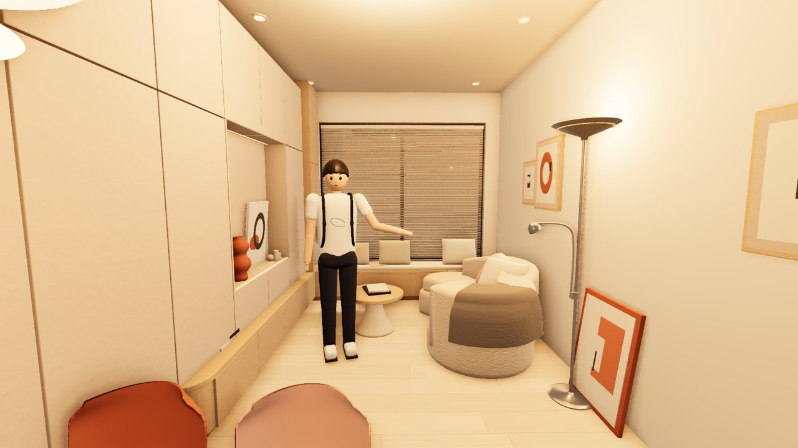
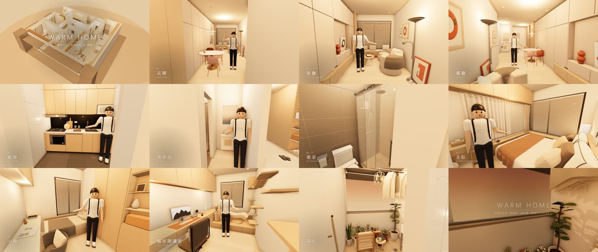

# WARM HOME · 暖光住宅室內設計 3D 導覽

**線上瀏覽：https://loveyu18.github.io/ai-video/**

用 three.js 做的室內設計導覽。整間屋子、家具、材質紋理、導覽員、配樂都用程式生成：**沒有 3D 模型、沒有貼圖、沒有照片**。



## 在網站上可以做什麼

- **▶ 播放 90 秒導覽**：鏡頭走過 10 個空間，有旁白、配樂、房間字卡，還有一位導覽員走路帶路：坐沙發、在廚房炒菜、拉開淋浴拉門試水溫、坐在床邊。
- **🚶 走走看**（`?walk=1`）：第三人稱操作導覽員。**W A S D** 走動、**Shift** 跑、**滑鼠拖曳**轉視角、**滾輪**拉遠拉近；靠近沙發、床、爐台、淋浴間按 **E** 坐下、炒菜、開關淋浴拉門、試水溫，**Q** 揮手。會撞到家具和牆、鏡頭不穿牆（[`freeroam.js`](freeroam.js)）。
- **房間捷徑**：直接從某個房間開始看。
- **自由瀏覽**：鳥瞰整間屋子，拖曳旋轉、右鍵平移、滾輪縮放。



## 專案特色

- **單一座標來源**：牆、門窗、家具、燈光、運鏡、導覽員站位，所有座標都從 [`layout.js`](layout.js) 推出來，單位是公尺。
- **每次都一模一樣**：所有隨機都用固定種子（[`rng.js`](rng.js)），畫面只由時間決定，重新輸出的影片逐格相同。
- **分區施工**：每個空間一個檔案（[`rooms/`](rooms/)），共用材質（[`materials.js`](materials.js)）和造型工具（[`geo.js`](geo.js)）。造型工具包含倒角、會鼓起的抱枕、垂墜布料、車削器物等。
- **暖色光、寫實白平衡**：2700K～3500K 室內燈，套用約 3500K 的相機白平衡（暖白而不是橘色）；西南方低角度斜陽穿過百葉簾，加上環境遮蔽（GTAO）。
- **每間房的環境探針**（[`probes.js`](probes.js)）：間接光與反射取自房間本身的 360° 環景；別間房的燈不會穿牆照過來。紗簾、百葉簾有背光透亮，曝光 0.85 讓白牆保有光線漸層，四角微暗。
- **瀏覽順暢**：拖曳中用快速畫質（較低解析度、不做環境遮蔽），停下 0.2 秒補畫完整畫質；畫面沒變就不重畫。播放時會先量速度，電腦夠快就全程完整畫質。`node tools/bench.mjs` 可量每格耗時。
- **導覽員**（[`guide.js`](guide.js)）：風格化人物，有揮手和介紹手勢、呼吸、眨眼，嘴型依旁白音量開合。
  - **走位劇本**寫在 `layout.js` 的 `GUIDE.script`：走路（腳踏實地不滑步）、坐下起身、炒菜、拉門、試水溫。動作由 [`guide-motion.js`](guide-motion.js) 算出，兩種角色都用兩段式 IK 擺骨架；道具（鍋鏟、爐火、蒸氣、花灑出水）在 [`guide-props.js`](guide-props.js)。
  - 家具尺寸用 `node tools/measure.mjs 房間 名稱前綴` 量，互動位置照量到的數字寫進劇本。
  - 本機若有 `avatar/guide.vrm`（VRoid Studio 匯出），會改用 [`guide-vrm.js`](guide-vrm.js) 載入這個角色：五種嘴形依旁白音色切換、眼睛看鏡頭、頭髮有彈簧骨擺動，後背包仍由程式生成。
  - 角色檔不放進 git，網站上看到的是程式生成的導覽員；加 `&procguide=1` 可在本機強制用程式版。

## 在自己電腦上執行

```bash
npm install
npm run serve        # 開 http://localhost:5317/
```

| 網址參數 | 用途 |
|---|---|
| （無） | 首頁 |
| `?play=1` | 播放導覽（可加 `&t=秒數` 從某一秒開始） |
| `?walk=1` | 走走看（測試用：`&at=x,z` 出生點、`&yaw=度` 鏡頭方向、`&demo=KeyW+2,KeyE,wait+3` 自動按鍵、`&dbg=1` 顯示狀態） |
| `?t=24` | 停在影片第 24 秒的畫面 |
| `?room=kitchen` | 站在某個房間的角落看，房間名稱見 `layout.js` 的 `ROOMS` |
| `?cam=x,y,z&look=x,y,z` | 自訂鏡頭位置與注視點 |
| `&quality=fast` | 一律用快速畫質（顯示卡很弱時） |
| `&exposure=0.85`、`&probes=0`、`&bloom=1` | 調曝光、關掉環境探針、開柔光（比較用） |

## 輸出影片

需要 Chrome 或 Edge、[ffmpeg](https://ffmpeg.org/)，旁白另外需要 `python -m pip install edge-tts`。

```bash
npm run render       # 輸出 output/tour.mp4（1920×1080、30fps、90 秒，含旁白與配樂）
```

- **改旁白**：改 `layout.js` 裡 `CAMERA_PATH` 每個鏡頭的 `narration`。
- **改字卡**：改 `VIDEO.title` 和 `VIDEO.ending`。
- **換音樂**：`npm run render -- --music=你的音樂.mp3`。
- **不要旁白**：加 `--novoice`。
- **輸出單張高品質截圖**：加 `--pt=256 --from=格 --to=格+1`，用路徑追蹤渲染。
- **固定鏡頭近拍**：加 `--query="cam=x,y,z&look=x,y,z&fov=40"`，例如檢查導覽員的姿勢。
- **鏡頭之間走過去而不是淡出淡入**：在 `CAMERA_PATH` 的鏡頭加 `enter: { dur, via }`，`via` 可以寫門的 id（從門洞正中央穿過）、路徑點，或 `{ pos, look }`（經過時盯著某處，繞著主體轉）。改完跑 `node tools/check-camera.mjs`，再用影格表看一次。

### 影格表

一次看完整支片，用時間碼回頭精修（左上角印時間與鏡頭名稱，轉場中是橘底）：

```bash
node tools/sheet.mjs                                              # 整支片每 0.5 秒一格 → output/sheet/sheet-01.jpg…
node tools/sheet.mjs out/door --from=41 --to=46 --every=0.1       # 近看一段轉場
```

## 檢查工具

```bash
node tools/check-room.mjs kitchen   # 家具不超出房間、不擋門窗、每次結果相同、只用共用材質
node tools/check-guide.mjs          # 導覽員走路路線、站位不撞家具／牆／門片，走路速度合理，坐下高度對得上座面，鏡頭不在家具裡
node tools/check-camera.mjs         # 鏡頭轉場不穿牆、不穿家具、不貼著導覽員、速度不過快（--all 連固定鏡頭也查）
```

## 說明

- 旁白是屋主本人的聲音：用 [F5-TTS](https://github.com/SWivid/F5-TTS) 在本機依一段本人錄音複製音色（`tools/clone_voice.py`，錄音放在 `voice-ref/`，不進 git）。沒有錄音時改用 Microsoft Edge 的線上神經語音（`zh-TW-HsiaoChenNeural`），適合個人展示；商業用途建議改用 Azure 語音服務的正式授權。
- 格局參考實際屋況調整，平面尺寸為示意，與實際可能有差距。
